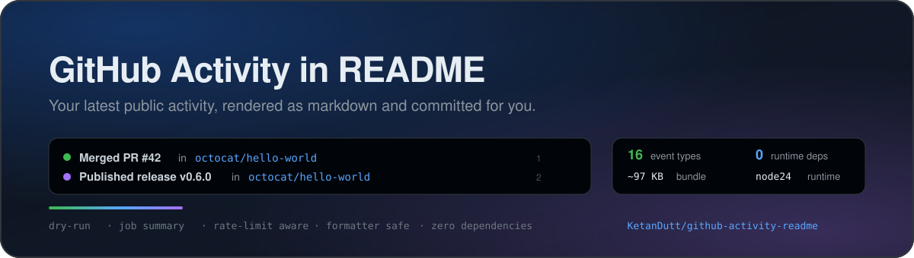

<p align="center">
  
</p>

<h1 align="center">GitHub Activity in README</h1>

<p align="center">
  Keep a section of your profile README in sync with your latest public GitHub
  activity.
</p>

<p align="center">
  <a href="action.yml"></a>
  <a href="CHANGELOG.md"></a>
  <a href="package.json"></a>
  <a href="LICENSE"></a>
</p>

---

## What it does

Add two markers to a markdown file. On every scheduled run, the action fetches
your public events, renders the newest ones, and commits the refreshed section:

```text
<!--START_SECTION:activity-->
1. 🎉 Merged PR [#42](https://github.com/octocat/hello-world/pull/42) in [octocat/hello-world](https://github.com/octocat/hello-world)
2. 🚀 Published release [v1.2.0](https://github.com/octocat/hello-world/releases/tag/v1.2.0) in [octocat/hello-world](https://github.com/octocat/hello-world)
3. 🗣 Commented on issue [#7](https://github.com/octocat/hello-world/issues/7) in [octocat/hello-world](https://github.com/octocat/hello-world)
4. ❗ Opened issue [#8](https://github.com/octocat/hello-world/issues/8) in [octocat/hello-world](https://github.com/octocat/hello-world)
5. 🔒 Closed issue [#9](https://github.com/octocat/hello-world/issues/9) in [octocat/hello-world](https://github.com/octocat/hello-world)
<!--END_SECTION:activity-->
```

The section is replaced as a whole, so `MAX_LINES` works when the list grows or
shrinks. The rest of the file is left untouched.

## Features

- **16 event types** — pull requests, reviews, issues, comments, releases,
  pushes, branches, tags, forks, stars, wikis, collaborators, and more.
- **Correct pull request states** — merged PRs are celebrated, plain closes are
  not.
- **Multiple users** — `GH_USERNAME` accepts a comma separated list.
- **Optional timestamps** — deterministic dates, UTC datetimes, or relative
  times.
- **Custom sections and files** — manage several sections with `SECTION_NAME`
  and `TARGET_FILE`.
- **Repository filters** — hide noisy repositories with `EXCLUDE_REPOS` globs.
- **No runtime dependencies** — the bundle is ~97 KB, down from ~1.2 MB, and
  `npm audit` is clean.
- **Resilient** — request retries, rate-limit handling, timeouts, and
  push-conflict rebasing.
- **Safe** — untrusted event text is markdown-escaped, tokens are masked, and
  `TARGET_FILE` cannot escape the workspace.
- **Observable** — outputs, annotations, debug logs, and a job summary.
- **Testable locally** — a dry-run preview renderer and 140 tests, with no CI
  required.
- **Formatter-friendly** — preserves CRLF, BOMs, trailing newlines, and blank
  lines, and ignores markers inside code fences.
- **GHES-ready** — honors `GITHUB_API_URL` and `GITHUB_SERVER_URL`.

## Quick start

### 1. Add the markers

In the file you want to update (usually `README.md`):

```md
## Recent activity

<!--START_SECTION:activity-->
<!--END_SECTION:activity-->
```

Commit the change. If you leave out the `END` marker, the action inserts
it after the generated list on the first run.

### 2. Add a workflow

`.github/workflows/activity.yml`:

```yaml
name: Update README activity

on:
  schedule:
    - cron: "0 */6 * * *" # every 6 hours, in UTC
  workflow_dispatch:

permissions:
  contents: write

jobs:
  update:
    runs-on: ubuntu-latest
    steps:
      - uses: actions/checkout@v5
      - uses: KetanDutt/github-activity-readme@master
        env:
          GITHUB_TOKEN: ${{ secrets.GITHUB_TOKEN }}
```

### 3. Run it

Trigger the workflow once with **Run workflow**. Start with `DRY_RUN: true` if
you want to inspect the result without a commit:

```yaml
- uses: KetanDutt/github-activity-readme@master
  with:
    DRY_RUN: true
  env:
    GITHUB_TOKEN: ${{ secrets.GITHUB_TOKEN }}
```

> [!IMPORTANT]
> This repository intentionally has **no CI**. Never add GitHub Actions
> workflows (`.github/workflows/`) or any other CI configuration to this
> repository — see the [No CI policy](CONTRIBUTING.md#no-ci-policy). The workflow
> above belongs in **your** profile/README repository, not here.

## Configuration

Every input is optional; `GH_USERNAME` defaults to the repository owner and the
token defaults to the `GITHUB_TOKEN` environment variable.

| Input               | Default                                                       | Description                                                  |
| ------------------- | ------------------------------------------------------------- | ------------------------------------------------------------ |
| `GH_USERNAME`       | `${{ github.repository_owner }}`                              | One username, or a comma separated list of up to 10.         |
| `COMMIT_NAME`       | `github-actions[bot]`                                         | Git author/committer name.                                   |
| `COMMIT_EMAIL`      | `41898282+github-actions[bot]@users.noreply.github.com`       | Git author/committer email.                                  |
| `COMMIT_MSG`        | `:zap: Update README with the recent activity`                | Commit message when the section changes.                     |
| `EMPTY_COMMIT_MSG`  | `:memo: Empty commit to keep the scheduled workflow active`   | Commit message for the keep-alive commit.                    |
| `MAX_LINES`         | `5`                                                           | Number of activity lines to render (1–100).                  |
| `TARGET_FILE`       | `README.md`                                                   | Repository-relative markdown file to update.                 |
| `SECTION_NAME`      | `activity`                                                    | Marker name; letters, numbers, `-`, and `_` only.            |
| `FILTER_EVENTS`     | `IssueCommentEvent,IssuesEvent,PullRequestEvent,ReleaseEvent` | Comma separated event types, or `*` for all supported types. |
| `EXCLUDE_REPOS`     | _(empty)_                                                     | Comma separated `owner/repo` globs to hide.                  |
| `SHOW_TIMESTAMPS`   | `false`                                                       | Append a timestamp to each line.                             |
| `TIMESTAMP_FORMAT`  | `date`                                                        | `date`, `datetime`, or `relative`.                           |
| `EMPTY_COMMIT_DAYS` | `50`                                                          | Keep-alive threshold in days; `0` disables it.               |
| `DRY_RUN`           | `false`                                                       | Render and summarize without writing or committing.          |
| `GITHUB_TOKEN`      | `GITHUB_TOKEN` / `GH_TOKEN` env                               | Optional token input when passing `env` is inconvenient.     |

Full details, validation rules, outputs, GHES notes, and multi-section examples
live in [docs/configuration.md](docs/configuration.md).

## Supported events

`FILTER_EVENTS` is an exact, case-insensitive set. The four default types are
marked below; use `*` to show everything.

| Event                           | Default | Renders                                                         |
| ------------------------------- | :-----: | --------------------------------------------------------------- |
| `CommitCommentEvent`            |    —    | Commented on a commit                                           |
| `CreateEvent`                   |    —    | Created a branch, tag, or repository                            |
| `DeleteEvent`                   |    —    | Deleted a branch or tag                                         |
| `ForkEvent`                     |    —    | Forked a repository                                             |
| `GollumEvent`                   |    —    | Updated the wiki                                                |
| `IssueCommentEvent`             |   ✅    | Commented on an issue or pull request                           |
| `IssuesEvent`                   |   ✅    | Opened, closed, labeled, assigned, and other issue actions      |
| `MemberEvent`                   |    —    | Added, removed, or changed a collaborator                       |
| `PublicEvent`                   |    —    | Made a repository public                                        |
| `PullRequestEvent`              |   ✅    | Opened, merged, closed, reviewed, labeled, and other PR actions |
| `PullRequestReviewCommentEvent` |    —    | Commented during a review                                       |
| `PullRequestReviewEvent`        |    —    | Approved, requested changes, dismissed, or reviewed             |
| `PullRequestReviewThreadEvent`  |    —    | Resolved, reopened, or outdated a review thread                 |
| `PushEvent`                     |    —    | Pushed one or more commits                                      |
| `ReleaseEvent`                  |   ✅    | Published, edited, or deleted a release                         |
| `WatchEvent`                    |    —    | Starred a repository                                            |

See [docs/events.md](docs/events.md) for examples, action-level handling,
timestamp formats, and API limits.

## Outputs

| Output           | Description                                           |
| ---------------- | ----------------------------------------------------- |
| `changed`        | `true` when the target file was updated.              |
| `activity_count` | Number of rendered activity lines.                    |
| `target_file`    | File that was managed.                                |
| `result`         | `updated`, `unchanged`, `empty-commit`, or `dry-run`. |
| `commit_sha`     | SHA of the pushed commit, when one was created.       |

```yaml
- uses: KetanDutt/github-activity-readme@master
  id: activity
  env:
    GITHUB_TOKEN: ${{ secrets.GITHUB_TOKEN }}

- run: echo "changed=${{ steps.activity.outputs.changed }}"
```

## Recipes

### Show timestamps

```yaml
with:
  SHOW_TIMESTAMPS: true
  TIMESTAMP_FORMAT: date # date | datetime | relative
```

### Track multiple users

```yaml
with:
  GH_USERNAME: "octocat,hubot"
  MAX_LINES: 10
```

### Show every event type

```yaml
with:
  FILTER_EVENTS: "*"
  MAX_LINES: 10
```

### Hide noisy repositories

```yaml
with:
  EXCLUDE_REPOS: "some-org/ci-notes,*/dotfiles"
```

### Manage two sections

```yaml
- uses: KetanDutt/github-activity-readme@master
  with:
    SECTION_NAME: activity
    TARGET_FILE: README.md
    MAX_LINES: 5
- uses: KetanDutt/github-activity-readme@master
  with:
    SECTION_NAME: releases
    TARGET_FILE: docs/releases.md
    FILTER_EVENTS: "ReleaseEvent"
    MAX_LINES: 10
```

### Write to a different file

```yaml
with:
  TARGET_FILE: docs/activity.md
  SECTION_NAME: activity
```

## How it works

1. **Validate** — inputs, markers, target path, and token are checked before any
   network call.
2. **Fetch** — the action requests `/users/{user}/events/public` for each user,
   in parallel, paginating up to three pages when needed.
3. **Filter and format** — events are filtered by type and repository, merged,
   de-duplicated, sorted newest-first, and rendered as escaped markdown.
4. **Replace** — only the lines between your markers change. The action can add
   a missing `END` marker, preserves CRLF/BOM/trailing newlines, and ignores
   markers inside code fences.
5. **Commit and push** — only `TARGET_FILE` is committed. Concurrent pushes are
   rebased and retried.

The whole implementation is dependency-free: a small `fetch` client and a
workflow-command logger replace Octokit and `@actions/core`. That took the
bundle from ~1.2 MB to ~97 KB.

When nothing changes, the action can create an empty commit after
`EMPTY_COMMIT_DAYS` (default 50) so GitHub does not disable the scheduled
workflow after 60 idle days.

## Local preview

Preview the exact markdown without writing a file or running git:

```bash
npm ci
export GITHUB_TOKEN=ghp_...
npm run preview -- --username octocat
npm run preview -- --username octocat --max-lines 10 --show-timestamps
npm run preview -- --username octocat --filter "*" --exclude-repos "*/dotfiles"
```

The token is optional for previews (unauthenticated requests are limited to 60
per hour). See [docs/development.md](docs/development.md#local-preview).

## Limits and behavior

- **Public events only.** GitHub does not expose another user's private events.
- **Last 90 days, up to 300 events** (three pages of 100).
- `MAX_LINES` is 1–100 and `GH_USERNAME` accepts up to 10 users.
- One section per `SECTION_NAME` per file; use multiple steps for multiple
  sections.
- Scheduled workflows run on the default branch; use `workflow_dispatch` for
  other branches.
- `TIMESTAMP_FORMAT: relative` changes over time and can create a commit on
  every run. Prefer `date` for scheduled runs.
- The Actions bot must be allowed to push to the target branch.

## Troubleshooting

| Symptom                             | Fix                                                                                 |
| ----------------------------------- | ----------------------------------------------------------------------------------- |
| `Couldn't find the section markers` | Check `SECTION_NAME`, `TARGET_FILE`, and that the marker is outside a fence.        |
| No lines in the section             | Try `FILTER_EVENTS: "*"`; activity may be private, older than 90 days, or filtered. |
| Push rejected / permission denied   | Add `permissions: contents: write` and keep checkout credentials enabled.           |
| `MAX_LINES` ignored                 | Update to 0.6.0+; older versions did not resize the section.                        |
| Scheduled workflow stopped          | GitHub disables idle schedules after 60 days; keep `EMPTY_COMMIT_DAYS` > 0.         |

The full checklist is in [docs/troubleshooting.md](docs/troubleshooting.md).

## Security

- Grant only `contents: write`; the action needs nothing else.
- The token is masked and redacted from logs and errors.
- Event text is escaped before it enters markdown or logs.
- `TARGET_FILE` must resolve inside the workspace, including through symlinks.
- There are no runtime dependencies; `npm audit` is clean.
- For maximum supply-chain safety, pin the action to a reviewed commit SHA.

Read [SECURITY.md](SECURITY.md) and [docs/security.md](docs/security.md) before
deploying in a sensitive repository.

## Documentation

| Guide                                      | Contents                                            |
| ------------------------------------------ | --------------------------------------------------- |
| [Configuration](docs/configuration.md)     | Inputs, outputs, tokens, GHES, multiple sections    |
| [Events](docs/events.md)                   | All 16 event types, filters, timestamps, formatting |
| [Architecture](docs/architecture.md)       | Modules, data flow, retries, section algorithm      |
| [Troubleshooting](docs/troubleshooting.md) | Common errors and fixes                             |
| [Development](docs/development.md)         | Setup, tests, preview, build, release checklist     |
| [Security](docs/security.md)               | Threat model, token hygiene, reporting              |
| [Changelog](CHANGELOG.md)                  | Release history                                     |

## Development

Requires Node.js 20+ (24 recommended) and git.

```bash
npm ci
npm test            # 140 local tests
npm run format      # Prettier
npm run build       # rebuild dist/index.js
npm run verify      # format check + tests + build
```

`dist/index.js` is committed because JavaScript actions run without an install
step. Never edit it by hand. There is no CI; see the
[contribution guide](CONTRIBUTING.md).

## Contributing

Contributions are welcome. Please read [CONTRIBUTING.md](CONTRIBUTING.md) and
the [Code of Conduct](CODE_OF_CONDUCT.md).

> [!IMPORTANT]
> This project intentionally remains **CI-free**. Do not add
> `.github/workflows/` or any other CI configuration to this repository.

## License

This project uses a [custom license](LICENSE). It is **not** open source for
commercial use, and it may not be used to train machine-learning models without
prior written permission. Contact `ketan6196@gmail.com` for licensing.

## Acknowledgements

- Originally based on
  [jamesgeorge007/github-activity-readme](https://github.com/jamesgeorge007/github-activity-readme)
  by James George.
- Inspired by [JasonEtco/activity-box](https://github.com/JasonEtco/activity-box).
- Thanks to everyone who reported bugs, suggested events, and reviewed the
  rewrite.
